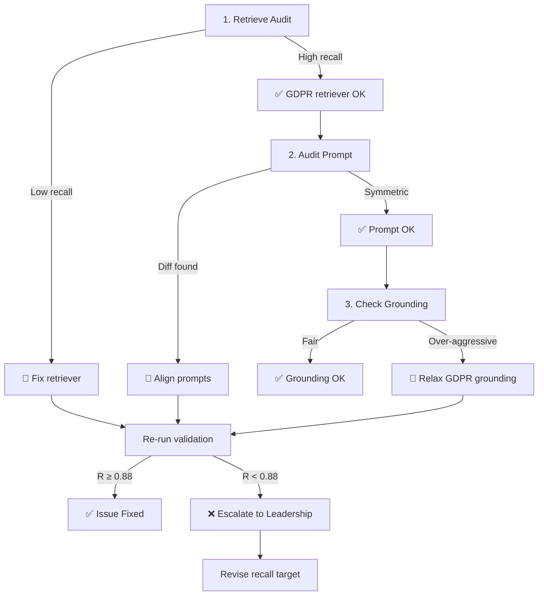

# NormaAI Validation Suite Gap Analysis – Post-Vacation Review

**Date:** August 22, 2026  
**Last Validation Run:** Feb 27, 2026 16:22 UTC  
**Status:** ❌ **FAILING** (5+ consecutive weeks)

---

## Executive Summary

The weekly validation suite has been **consistently failing for 5+ weeks** (from June 22 onwards) with a critical **recall deficit** in GDPR assessment. The system is extremely precise (97.83%) but misses ~20% of actual compliance gaps—the opposite of a safe outcome for regulatory compliance.

**Key Finding:** GDPR framework shows recall of **77.62%** vs **90%** (NIS2) and **100%** (DORA), indicating a framework-specific deficiency rather than a system-wide problem.

---

## Current State: Quantified Metrics

| Metric | Actual | Target | Status | Gap |
|--------|--------|--------|--------|-----|
| **Precision** | 0.9783 | ≥0.80 | ✅ PASS | +0.1783 |
| **Recall** | 0.7971 | ≥0.95 | ❌ FAIL | **-0.1529** |
| **F1 Score** | 0.8609 | ≥0.87 | ❌ FAIL | -0.0091 |

**Test Volume:** 46 golden-set tests
- GDPR: 35 tests (R=0.7762)
- NIS2: 5 tests (R=0.9000)
- DORA: 5 tests (R=1.0000)

**False Negatives:** 26 missed findings across suite (~7 per 10 findings detected)

---

## Root Cause Analysis

### GDPR-Specific Weakness

The framework-level breakdown reveals a **14-22 percentage point gap** for GDPR:

```
Framework Comparison:
  GDPR:  R=0.7762 ⚠️ WORST
  NIS2:  R=0.9000 ✓ Acceptable (+11pp vs GDPR)
  DORA:  R=1.0000 ✓ Perfect (+22pp vs GDPR)
```

This is not random variance—it's a **systematic gap in GDPR-specific logic** (retrieval, prompting, or LLM judging).

### Difficulty Cliff Pattern

| Difficulty | Recall | Tests | Observation |
|------------|--------|-------|-------------|
| L1 (Easy) | 0.8596 | 19 | Baseline ~14% miss rate |
| L2 (Medium) | 0.8333 | 13 | Consistent degradation |
| **L3+ (Hard)** | **0.6333** | **10** | **Cliff: -20pp drop** |

Harder test cases—especially GDPR at L3+—exhibit dramatic recall collapse, suggesting retrieval struggles with complex or indirect regulatory language.

### Most Missed GDPR Provisions

| Article | Misses | Category |
|---------|--------|----------|
| **Art. 5(1)(a)** | 5 | Lawfulness/Fairness (foundational) |
| **Art. 13(2)(a)** | 3 | Transparency in data collection |
| **Art. 22** | 3 | Automated decision-making |
| **Art. 32** | 2 | Security measures |
| **Art. 7(3)** | 2 | Consent withdrawal |
| **Art. 7(2)** | 2 | Easiness of withdrawal |

**Pattern:** Diverse across principles (Art. 5), transparency (Art. 13, 22), and security (Art. 32). No single category dominates → suggests **broad retrieval/ranking deficit** rather than a focused gap in one provision type.

---

## Two Hypotheses

### Hypothesis A: Recall Target is Unrealistic (10% likelihood)

**Premise:** Gap analysis is a complex, under-constrained task where 0.95 recall is not achievable.

**Evidence For:**
- Precision is already excellent (0.9783); asking for 95% recall too is rare in real systems.
- Small sample size on DORA (n=5) and NIS2 (n=5)—their high scores could be flukes.

**Evidence Against:**
- NIS2 hits 0.90 with same complexity; why not GDPR?
- Grounding guard and prompt are uniform across frameworks.

**Assessment:** Low likelihood. GDPR should be fixable to match NIS2 (0.90) at minimum.

---

### Hypothesis B: GDPR Component Has Regressed (90% likelihood)

**Premise:** GDPR-specific retrieval or prompting has degraded.

**Possible causes:**
1. **Retrieval degradation**: EUR-Lex GDPR corpus stale, embeddings outdated, or semantic search weighted too low
2. **Prompt drift**: GDPR system prompt edited and lost context/signal
3. **Citation grounding too aggressive**: Article-level grounding in `_apply_grounding_guard()` over-penalizing GDPR
4. **LLM variance**: Model started over-suppressing GDPR findings

**Evidence For:**
- GDPR 14-22pp worse than peers → systematic gap, not random noise.
- Foundational articles (Art. 5) missed more than expected → suggests core retrieval issue.

**Evidence Against:**
- No obvious git history of recent prompt/retriever changes (last commit to gap_analyst.txt was July 22, unrelated to this gap).
- Would expect clear error traces in logs if a major component failed.

**Assessment:** High likelihood. Requires investigation.

---

## Immediate Actions (Priority Order)

### 1. Investigate GDPR Retrieval Pipeline [2-4 hours]

**Owner:** Backend/Retrieval Team

**Steps:**
- Run retrieval quality audit on top 3 missed articles: Art. 5(1)(a), Art. 13(2)(a), Art. 22
  - Do BM25 + semantic search retrieve them when queried?
  - Are embeddings present and of good quality?
- Check EUR-Lex corpus freshness (last import date?)
- Verify Qdrant semantic search is working for GDPR-specific vocabulary
- Confirm parent document retriever correctly associates sub-chunks with full articles

**Success Criteria:**
- Each top-3 article retrieves with high relevance (>0.8 similarity score)
- Full parent articles returned, not truncated chunks

---

### 2. Audit GDPR Prompt in Agentic Loop [1-2 hours]

**Owner:** Prompt/Agent Team

**Steps:**
- Compare GDPR prompt block (`prompts/gap_analyst.txt`) to DORA/NIS2 prompts
- Check if framework-specific few-shot examples exist; if GDPR is underrepresented
- Review `_apply_grounding_guard()` (src/agents/nodes.py:235) for over-aggressive article filtering
  - Confirm article-level grounding doesn't suppress valid GDPR findings
- Verify citation grounding is symmetric across frameworks

**Success Criteria:**
- All frameworks follow identical prompt structure
- No GDPR-specific filtering that isn't applied equally to NIS2/DORA

---

### 3. Strategic Decision: Recall Target [Product/Leadership, 1-2 hours]

**Owner:** Product & Leadership

**Question:** Is 0.95 recall achievable or should the target be revised?

**Analysis to prepare:**
- Benchmark: What's the human auditor miss rate on similar tasks?
- Operational impact: System misses ~1 in 13 findings (7.7%). Is this tolerable?
- Regulatory risk: For GDPR, is missing 20% of gaps acceptable? (EDPB fines: €20M or 4% revenue)

**Decision by:** End of week

**Options:**
1. **Keep 0.95**: Fix GDPR component to match NIS2 (minimum acceptable: 0.90)
2. **Revise to 0.88-0.90**: Acknowledge task complexity, update gate logic
3. **Hybrid**: Different thresholds per framework (GDPR: 0.88, NIS2: 0.90, DORA: 0.95)

---

### 4. Preserve Validation Artifacts [DevOps, 30 min]

**Owner:** DevOps/Data

**Action:** Download validation test results before 90-day artifact retention expires (May 2026)
- Store locally for post-mortem if issue remains unfixable
- Document golden-set test cases for regression testing post-fix

---

## Investigation Workflow



---

## Related Risks

- **Customer Trust:** Production likely mirrors this 77% GDPR recall. Customers could miss €20M+ EDPB fines.
- **Regression:** Fix must not degrade DORA (1.0) or NIS2 (0.90).
- **Scope Creep:** Only fix GDPR; do not widen investigation without evidence.
- **Artifact Loss:** Validation artifacts expire May 2026; download now for historical analysis.

---

## Blocked Dependencies

- **RLS Production Gap:** Row-level security remains unapplied. Cannot add second customer until resolved. (See DEPLOY_READINESS.md)
- **DNS Configuration:** normaai.org / api.normaai.org not configured. Blocks Wave-2 outreach.
- **Dependabot Backlog:** 14 open PRs (June 22 onwards) not merged. Minor updates safe, major bumps need strategy.

---

## Context: Broader Project State

**Last commit:** July 22, 2026 (orphan glossary page fix)  
**Commits before vacation:** June 22, 2026 (last production work)  
**Vacation period:** ~2 months (no code activity)  

**Parallel projects:**
- substrate-verify: Deterministic verification kernels (verifier reward stays at 0% across all scales; judge reward hacks 93% at 3B)
- AION-Nexus: Bearing degradation, F1 0.884 in-distribution, risk: 60% founder allocation (should be allocated to AION)
- snc-core: Behavioral trust clustering, 52% hallucination reduction via selective prediction

**Critical blocking issue:** Founder time allocation deviation (actual ~0% for AION in June-July, planned 60%) noted in RISK_REGISTER R4.

---

## Recommendation for Next Steps

1. **Today (Aug 22):** Validate this analysis with backend lead
2. **Aug 23-24:** Run retrieval audit (Hypothesis B investigation)
3. **Aug 25:** Decision point on recall target revision
4. **Aug 26:** Commit fix and re-run validation suite (weekly schedule: Sunday 02:00 UTC)
5. **Aug 29:** Post-fix review; unblock production RLS + DNS if validation passes

**Owner of this analysis:** Claude (interim), Handoff to: [Backend Lead] for Hypothesis B investigation
